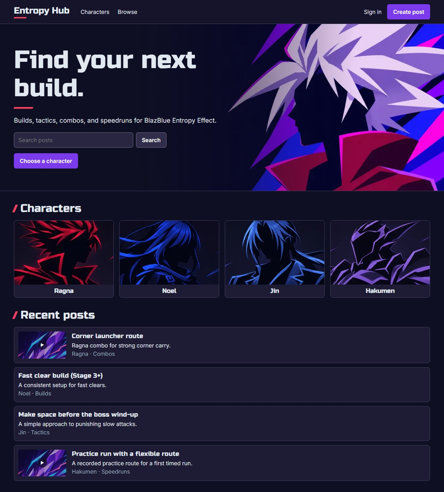
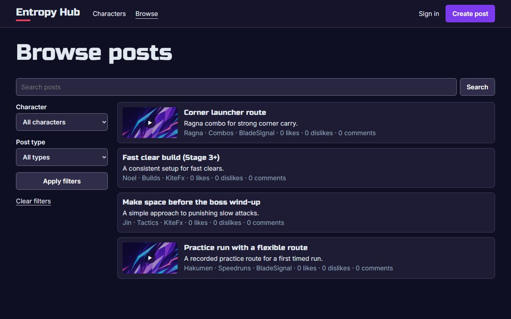
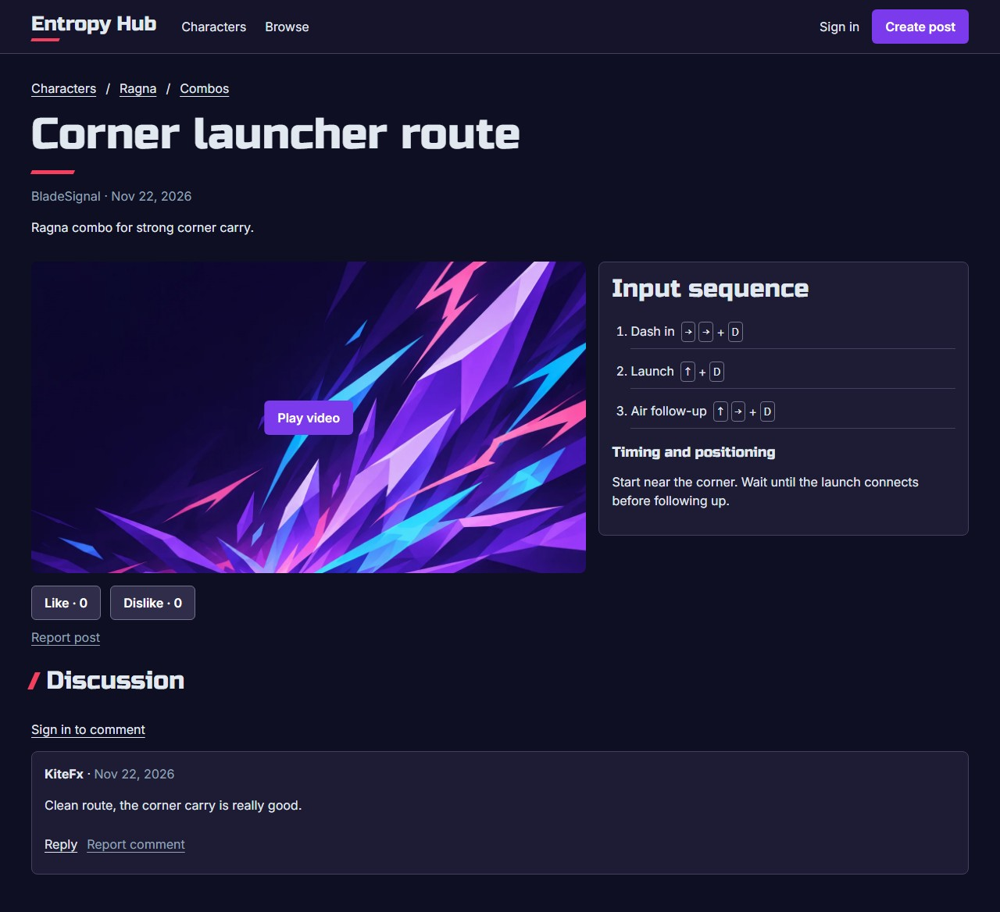

# Entropy Hub

An unofficial community site for BlazBlue Entropy Effect players.

## Find builds, tactics, combos, and speedruns

Search community posts or filter by character and post type. Open a character page to see posts for that fighter.

## Watch a clip and follow the inputs

Combo posts show the input sequence and timing notes alongside a clip when one is attached. Speedrun posts include a recording, the category, a self-reported time, and route notes when the author adds them.

Sign in to publish posts, upload combo clips or speedrun recordings, and join the discussion with reactions, comments, and replies.

## Documentation

- [Developer guide](docs/DEVELOPMENT.md) for local setup, testing, and deployment
- [Product brief](docs/PRODUCT_BRIEF.md)
- [UI design](docs/UI_DESIGN.md)
- [Implementation plan](docs/IMPLEMENTATION_PLAN.md)
